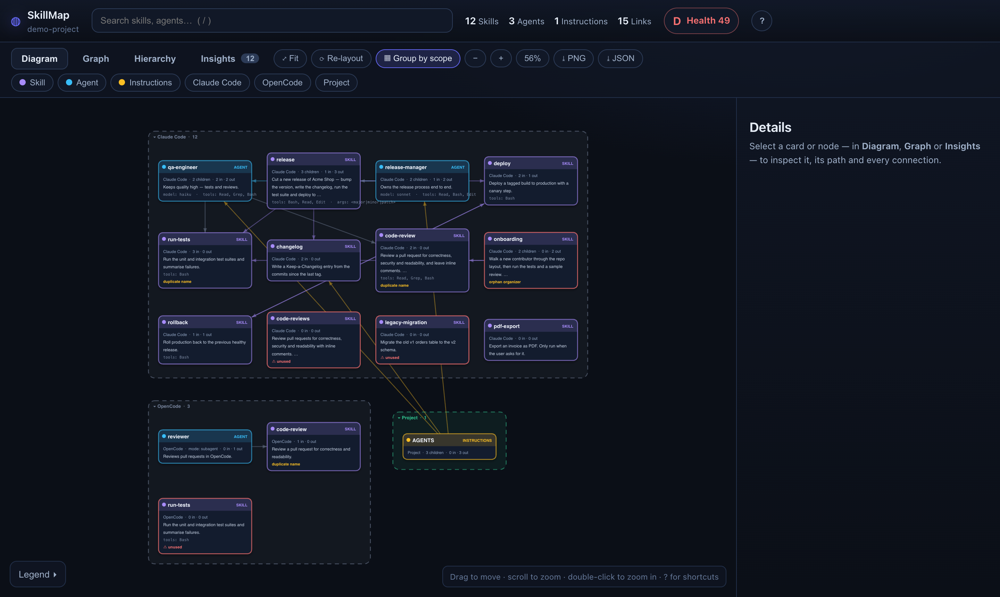
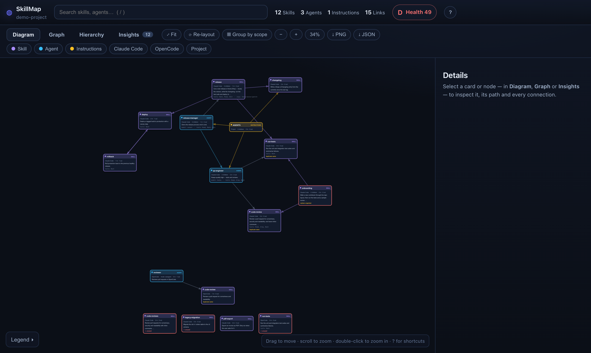
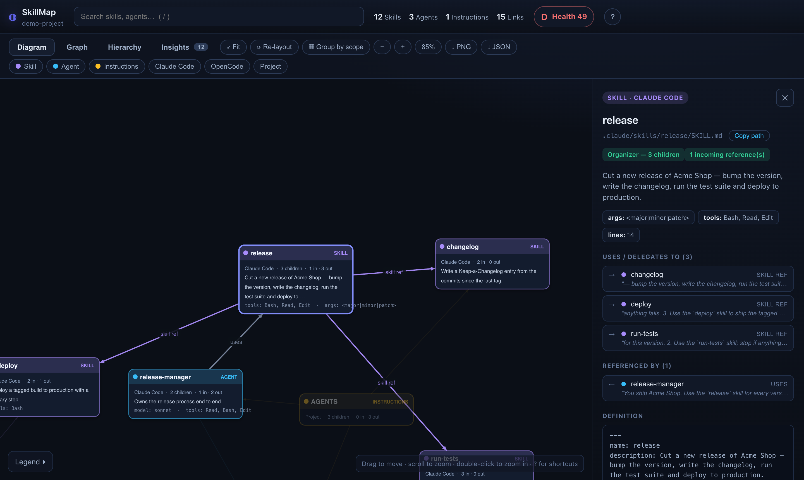
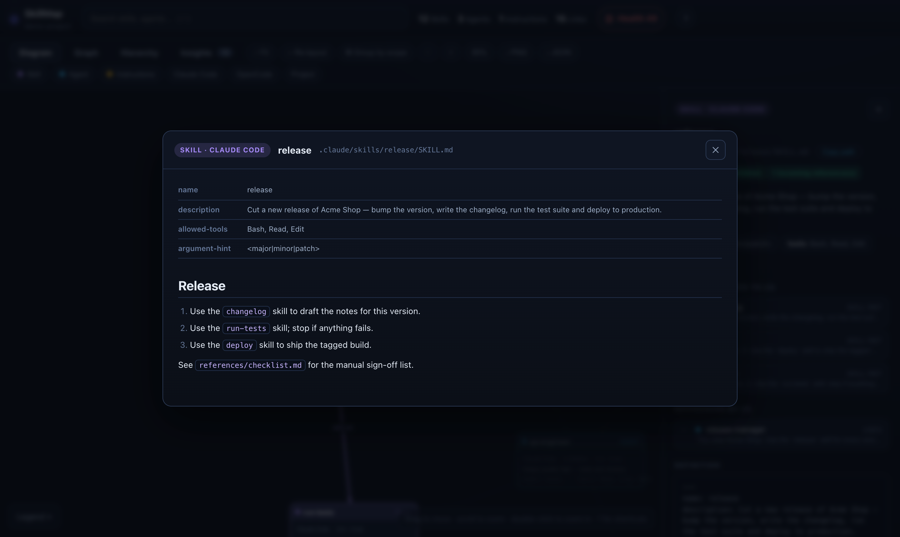
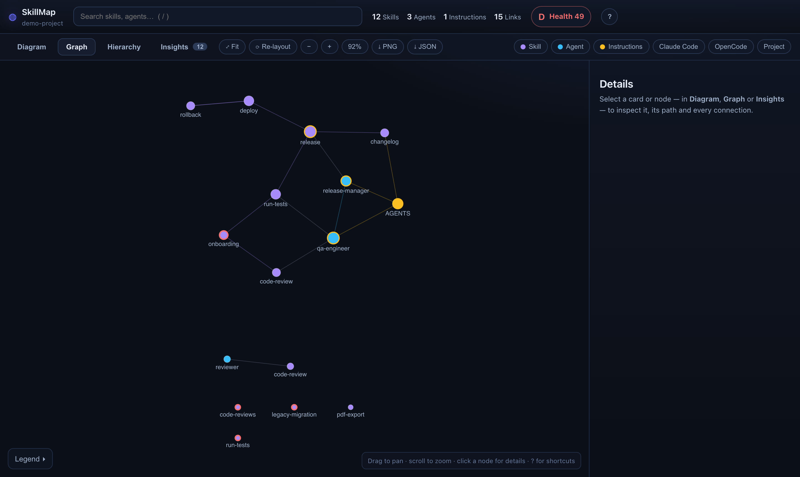
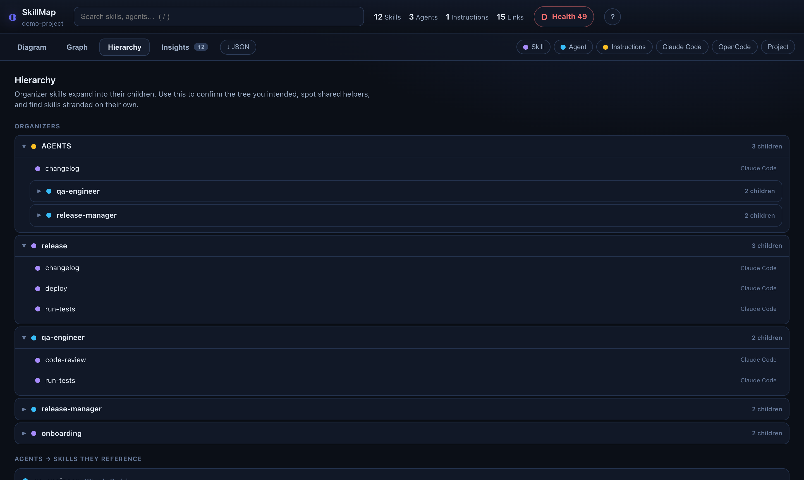
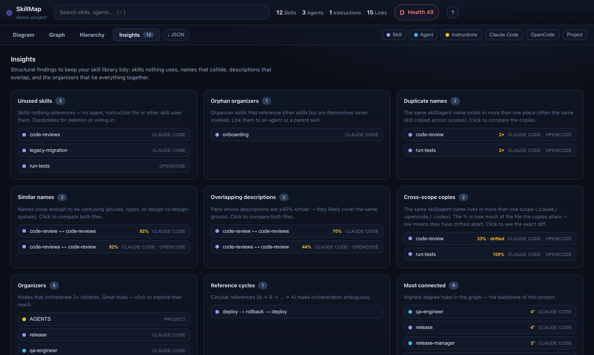
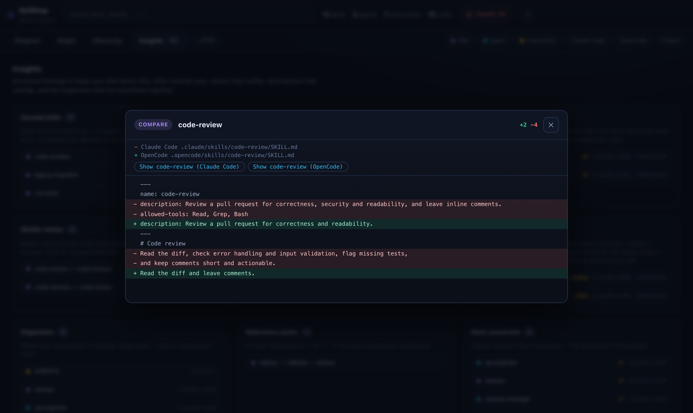

# SkillMap

Point it at an AI project folder. It finds every **skill**, **agent** and
**instruction file** (Claude Code, OpenCode, Codex, Cursor, Gemini, `AGENTS.md`…),
works out how they reference each other, and renders one self-contained,
interactive HTML report — so you can stop maintaining skills nobody uses,
skills that overlap, and copies that have quietly drifted apart.

No dependencies. No build step. One Node command (Node 18+).

```bash
node bin/skillmap.mjs <project-folder> --open
```



## Contents

- [Quick start](#quick-start)
- [Try it on the demo project](#try-it-on-the-demo-project)
- [Examples](#examples)
- [The views](#the-views)
- [What it looks at](#what-it-looks-at)
- [How connections are derived](#how-connections-are-derived)
- [What it surfaces (Insights)](#what-it-surfaces-insights)
- [Usage](#usage)
- [Keyboard](#keyboard)
- [Layout](#layout)

## Quick start

```bash
git clone https://github.com/xente/skillmap.git
cd skillmap

# scan any project — the report is written to <project>/.skillmap/skillmap.html
node bin/skillmap.mjs ~/code/my-app --open
```

The terminal prints a summary:

```
  ◍  SkillMap · my-app
     /home/me/code/my-app
  ────────────────────────────────────────────────────────
     Skills 12   Agents 3   Instructions 1   Links 15
     Health D (49/100)
     Unused 4 · Duplicate names 2 · Similar names 2 · Overlapping descriptions 2 · Cycles 1

  ✔ Report written to /home/me/code/my-app/.skillmap/skillmap.html
```

To have `skillmap` available everywhere:

```bash
npm link                         # from the skillmap folder
skillmap ~/code/my-app --open
```

## Try it on the demo project

The repo ships with a small fake project, [`examples/demo-project`](examples/demo-project),
built to trigger every kind of finding:

```bash
node bin/skillmap.mjs examples/demo-project --open
```

```
examples/demo-project
├── AGENTS.md                         instructions → release-manager, qa-engineer, changelog
├── .claude/
│   ├── agents/
│   │   ├── release-manager.md        uses `release`, delegates to `qa-engineer`
│   │   └── qa-engineer.md            uses `run-tests`, `code-review`
│   └── skills/
│       ├── release/                  organizer → changelog, run-tests, deploy
│       ├── changelog/
│       ├── run-tests/
│       ├── deploy/   ⇄ rollback/     reference each other → cycle
│       ├── code-review/
│       ├── code-reviews/             near-duplicate of code-review, unused
│       ├── onboarding/               orchestrates skills but nobody calls it
│       ├── legacy-migration/         unused
│       └── pdf-export/               disable-model-invocation: manual only
└── .opencode/
    ├── agents/reviewer.md            uses `code-review`
    └── skills/
        ├── code-review/              copy that drifted from the .claude one
        └── run-tests/                identical copy, never used
```

What SkillMap finds in it:

| Finding | Where |
| --- | --- |
| Unused skills | `code-reviews`, `legacy-migration`, `run-tests` (OpenCode copy) |
| Orphan organizer | `onboarding` — calls `run-tests` and `code-review`, but nothing calls it |
| Manual only | `pdf-export` (`disable-model-invocation: true`) — not flagged as unused |
| Similar names / overlapping descriptions | `code-review` ↔ `code-reviews` |
| Cross-scope copies | `code-review` (33% shared — drifted), `run-tests` (100%) |
| Reference cycle | `deploy → rollback → deploy` |
| Organizers | `AGENTS.md`, `release`, `qa-engineer`, `release-manager`, `onboarding` |

## Examples

```bash
# the project you're standing in → ./.skillmap/skillmap.html
node bin/skillmap.mjs . --open

# write the report somewhere else
node bin/skillmap.mjs ~/code/my-app -o ~/reports/my-app.html

# also dump the raw graph as JSON (for scripting / CI)
node bin/skillmap.mjs ~/code/my-app -j skillmap.json
```

**Fail a CI job when skills go unused** — the JSON has the full analysis
(`analysis.unused` includes orphan organizers):

```bash
node bin/skillmap.mjs . -o /tmp/skillmap.html -j /tmp/skillmap.json
node -e '
  const { analysis, nodes } = require("/tmp/skillmap.json");
  const name = (id) => nodes.find((n) => n.id === id).rel;
  if (analysis.unused.length) {
    console.error("Unused skills:\n  " + analysis.unused.map(name).join("\n  "));
    process.exit(1);
  }'
```

**List copies that have drifted between tools:**

```bash
node -e '
  const { analysis } = require("/tmp/skillmap.json");
  for (const c of analysis.scopeDivergence.filter((c) => c.diverged))
    console.log(`${c.name}: ${Math.round(c.similarity * 100)}% shared across ${c.scopes.join(", ")}`);'
```

**Commit the report or keep it local** — by default it lives in the scanned
project's `.skillmap/` folder. Commit it to share the map with your team, or
ignore it:

```bash
echo ".skillmap/" >> .gitignore
```

> The report embeds the contents of the scanned skill/agent files and the
> project's absolute path. Keep that in mind before publishing it.

## The views

### Diagram

UML-style cards, one per skill/agent/instruction file: name, kind, scope,
`mode`, child count, in/out references, a snippet of the description,
`model` / `tools` / `args`, and any finding (`unused`, `orphan organizer`,
`duplicate name`…). Arrows are typed edges, labelled on the focused card.
Nodes with no connections are lined up underneath the main cluster.



- Drag a card to move it, drag empty space to pan, scroll to zoom,
  double-click to zoom in. The `%` button shows the zoom and resets it to 100%.
- **▦ Group by scope** (`G`) packs the cards into one box per scope
  (`.claude`, `.opencode`, `.codex`, Project…). Click a group header to
  collapse/expand it.
- The layout is computed once and then **frozen** — filtering and searching
  only show/hide. Use **⟳ Re-layout** (`R`) for a fresh arrangement and
  **⤢ Fit** (`F`) to frame everything.

### Details drawer

Click any card or node. The drawer shows the path (with **Copy path**), flags,
description, frontmatter, and every connection **with the text snippet that
produced it** — so a false positive is obvious at a glance.



**⤢ Read full definition** (or `O`) opens the whole file rendered as Markdown —
frontmatter as a table, headings, lists, tables, code and links:



### Graph

The classic force-directed map. Color = kind, size = connectivity, red ring =
unused, amber ring = organizer.



### Hierarchy

Organizers expand into their children (recursively), followed by agents → the
skills they pull in, and any stranded skills.



### Insights

Every finding as a card. Pairs show both names; click one to compare the two
files side by side, or click a single item to jump to it on the map (filters
hiding it are lifted automatically).





Filters by kind and scope, plus the search box, isolate one tool or hunt for a
name. When something is hidden a banner says so, with a **Show all** button.

**Export:** **⤓ PNG** saves the current Diagram or Graph view;
**⤓ JSON** saves the full graph payload (nodes, edges, analysis).

## What it looks at

It scans the folder recursively (skipping `node_modules`, `.git`, `dist`,
`worktrees`, `.skillmap`, …) and recognises the conventions these tools use:

| Found | Treated as |
| --- | --- |
| `**/SKILL.md`, `<scope>/skills/<name>.md` | **Skill** |
| `**/agents/*.md`, `**/agent/*.md` (e.g. `.claude/agents`, `.opencode/agents`) | **Agent** |
| `AGENTS.md`, `CLAUDE.md`, `GEMINI.md`, `.cursorrules`, `.config/AGENTS/*.md` | **Instructions** |

Files that live *inside* a skill (`references/`, `scripts/`, `templates/`, …)
and `README.md` / `CHANGELOG.md` in those folders are ignored — they are part
of a skill, not skills themselves.

Frontmatter is parsed for `name`, `description`, `tools` / `allowed-tools`,
`model`, `mode`, `argument-hint` and `disable-model-invocation`. Scopes
(`.claude`, `.opencode`, `.codex`, `.cursor`, `.gemini`, `.github`, …) are
labelled automatically.

## How connections are derived

For every file it looks for deliberate references to other known
skills/agents/instructions:

- explicit paths — `` @./.claude/skills/changelog/SKILL.md ``
- backticked names — `` `run-tests` ``
- names preceded by a signal word — *skill, agent, delegate, orchestrate, use,
  read, usa, usar, lee, flujo, task, →* …
- distinctive names (hyphenated or long) anywhere in the text

A name that exists in several scopes is linked to the copy in the *same* scope
when there is one, and a file mentioning its own name never counts as using
its copies elsewhere — otherwise every copy would look "used".

Edges are typed:

- **skill ref** — a skill using another skill
- **delegates** — an agent handing off to another agent
- **instructs** — an instruction file pointing at skills/agents
- **path ref** — an explicit file path
- **uses** — anything else (e.g. an agent using a skill)

## What it surfaces (Insights)

- **Unused skills** — nothing references them. Candidates for deletion.
  Skills with `disable-model-invocation: true` are treated as manual commands,
  not unused.
- **Orphan organizers** — skills that orchestrate others but are themselves
  never invoked. Wire them into an agent or a parent.
- **Duplicate names** — the same skill/agent name in more than one place.
  Instruction files are excluded: one `AGENTS.md` per folder is the convention.
- **Similar names** — close enough to confuse (`design` vs `design-system`,
  plurals, typos).
- **Overlapping descriptions** — descriptions ≥40% token-similar (same-name
  copies are excluded; they are reported as cross-scope copies).
- **Cross-scope copies** — the same name in more than one scope. The % is how
  many lines of the file the copies share; a low % means they have **drifted
  apart**. Click one to see the line-by-line diff.
- **Reference cycles** — A → B → … → A, which make orchestration ambiguous.
- **Organizers** and **Most connected** — the hubs of the project.

The **Health** grade (A–F) in the top bar summarises all of the above.

## Usage

```
skillmap <project-folder> [options]

  -o, --out <file>   Output HTML file   (default: <project>/.skillmap/skillmap.html)
  -j, --json <file>  Also write the raw graph as JSON (for scripting/CI)
      --open         Open the report in your browser
  -h, --help         Show help
```

The output is a single HTML file with the data inlined — no server, no
network. Open it anywhere. If no skills, agents or instruction files are
found, nothing is written and the command exits with an error.

## Keyboard

| Key | Action |
| --- | --- |
| `/` | Search (Enter jumps to the first match, Esc clears) |
| `1`–`4` | Diagram · Graph · Hierarchy · Insights |
| `F` / `R` / `G` | Fit · Re-layout · Group by scope |
| `+` `-` `0` | Zoom in · out · 100% |
| `O` | Read the selected definition |
| `Esc` | Close dialog / clear selection |
| `?` | Shortcut help |

## Layout

```
bin/skillmap.mjs        CLI entry point
lib/scan.mjs            recursive scanner + frontmatter parser
lib/analyze.mjs         graph builder, duplicate/unused/cycle analysis
lib/report.mjs          inlines assets + data into one HTML file
assets/template.html    page shell
assets/app.css          styling
assets/app.js           diagram, graph, hierarchy and insights views
examples/demo-project   fake project used for the screenshots
docs/images             screenshots
```
