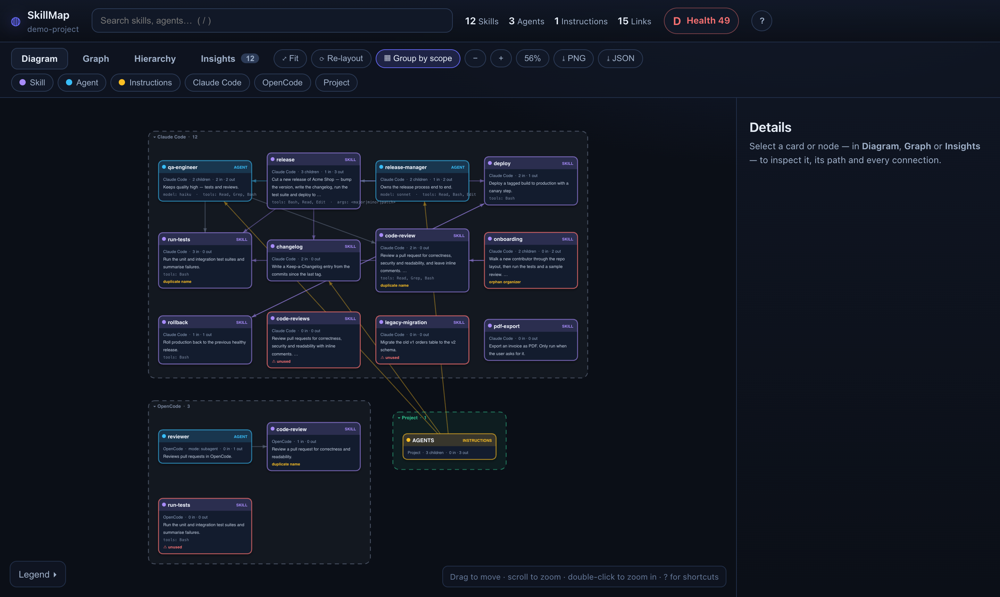
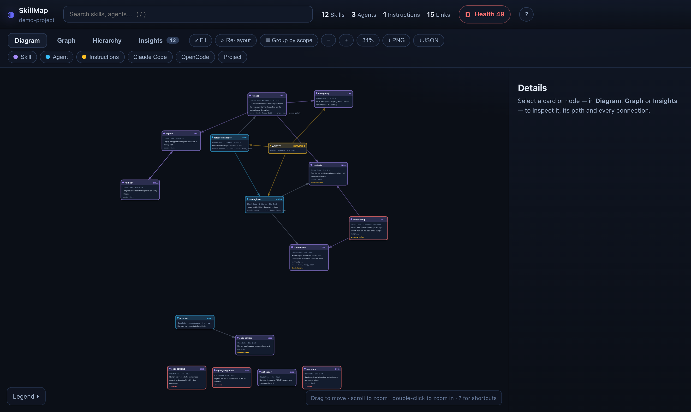
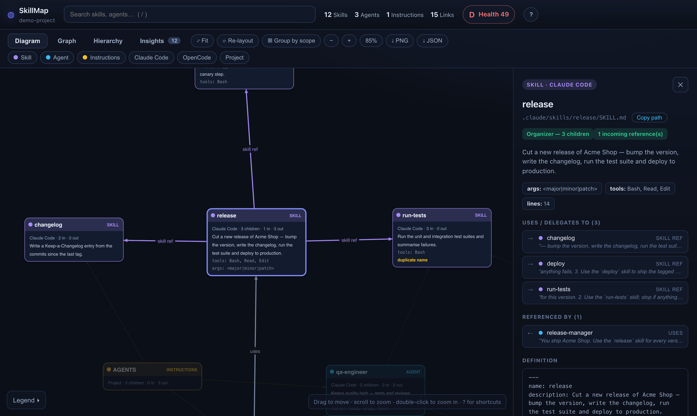
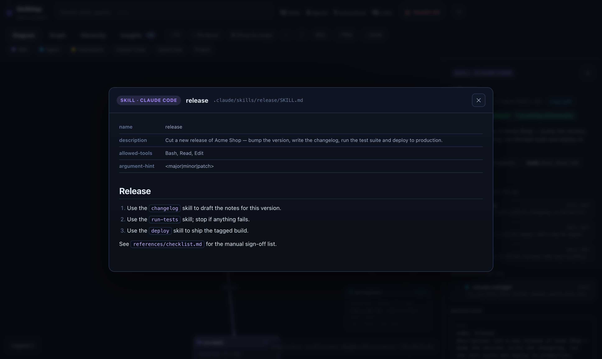
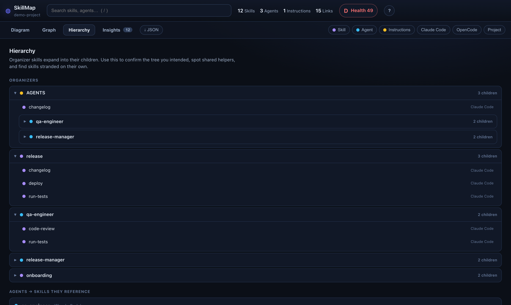
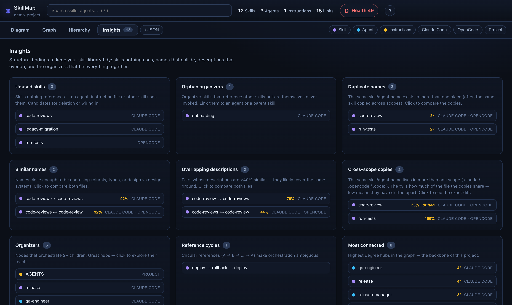
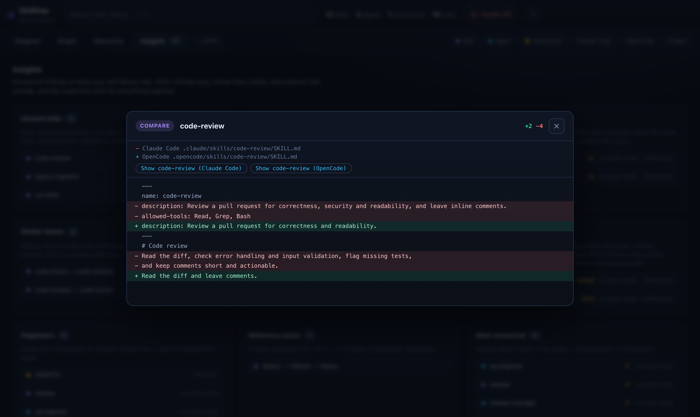

# SkillMap

Point it at an AI project folder. It finds every **skill**, **agent** and
**instruction file** (Claude Code, OpenCode, Codex, Cursor, Gemini, `AGENTS.md`…),
works out how they reference each other, and renders one self-contained,
interactive HTML report — so you can stop maintaining skills nobody uses,
skills that overlap, and copies that have quietly drifted apart.

If you use **OpenCode** or **Claude Code**, it also reads your local session history and shows what
actually happened at runtime: which skills and subagents ran, why, how long
each step took, and where the agent wasted time — down to a step-by-step
replay of every session.

No dependencies. No build step. One Node command (Node 18+; OpenCode sessions
need Node 22.5+).

```bash
node bin/skillmap.mjs <project-folder> --open
```



## Contents

- [Quick start](#quick-start)
- [Try it on the demo project](#try-it-on-the-demo-project)
- [Examples](#examples)
- [The views](#the-views)
- [What it looks at](#what-it-looks-at)
- [How connections are derived](#how-connections-are-derived)
- [What it surfaces (Insights)](#what-it-surfaces-insights)
- [Runtime: what actually happened (OpenCode, Claude Code)](#runtime-what-actually-happened-opencode-claude-code)
- [Global report: every project at once](#global-report-every-project-at-once)
- [Live mode and the herdr plugin](#live-mode-and-the-herdr-plugin)
- [Usage](#usage)
- [Keyboard](#keyboard)
- [Layout](#layout)

## Quick start

```bash
git clone https://github.com/xente/skillmap.git
cd skillmap

# scan any project — the report is written to <project>/.skillmap/skillmap.html
node bin/skillmap.mjs ~/code/my-app --open
```

The terminal prints a summary:

```
  ◍  SkillMap · my-app
     /home/me/code/my-app
  ────────────────────────────────────────────────────────
     Skills 12   Agents 3   Instructions 1   Links 15
     Health D (49/100)
     Unused 4 · Duplicate names 2 · Similar names 2 · Overlapping descriptions 2 · Cycles 1

  ✔ Report written to /home/me/code/my-app/.skillmap/skillmap.html
```

To have `skillmap` available everywhere:

```bash
npm link                         # from the skillmap folder
skillmap ~/code/my-app --open
```

## Try it on the demo project

The repo ships with a small fake project, [`examples/demo-project`](examples/demo-project),
built to trigger every kind of finding:

```bash
node bin/skillmap.mjs examples/demo-project --open
```

```
examples/demo-project
├── AGENTS.md                         instructions → release-manager, qa-engineer, changelog
├── .claude/
│   ├── agents/
│   │   ├── release-manager.md        uses `release`, delegates to `qa-engineer`
│   │   └── qa-engineer.md            uses `run-tests`, `code-review`
│   └── skills/
│       ├── release/                  organizer → changelog, run-tests, deploy
│       ├── changelog/
│       ├── run-tests/
│       ├── deploy/   ⇄ rollback/     reference each other → cycle
│       ├── code-review/
│       ├── code-reviews/             near-duplicate of code-review, unused
│       ├── onboarding/               orchestrates skills but nobody calls it
│       ├── legacy-migration/         unused
│       └── pdf-export/               disable-model-invocation: manual only
└── .opencode/
    ├── agents/reviewer.md            uses `code-review`
    └── skills/
        ├── code-review/              copy that drifted from the .claude one
        └── run-tests/                identical copy, never used
```

What SkillMap finds in it:

| Finding | Where |
| --- | --- |
| Unused skills | `code-reviews`, `legacy-migration`, `run-tests` (OpenCode copy) |
| Orphan organizer | `onboarding` — calls `run-tests` and `code-review`, but nothing calls it |
| Manual only | `pdf-export` (`disable-model-invocation: true`) — not flagged as unused |
| Similar names / overlapping descriptions | `code-review` ↔ `code-reviews` |
| Cross-scope copies | `code-review` (33% shared — drifted), `run-tests` (100%) |
| Reference cycle | `deploy → rollback → deploy` |
| Organizers | `AGENTS.md`, `release`, `qa-engineer`, `release-manager`, `onboarding` |

## Examples

```bash
# the project you're standing in → ./.skillmap/skillmap.html
node bin/skillmap.mjs . --open

# write the report somewhere else
node bin/skillmap.mjs ~/code/my-app -o ~/reports/my-app.html

# also dump the raw graph as JSON (for scripting / CI)
node bin/skillmap.mjs ~/code/my-app -j skillmap.json
```

**Fail a CI job when skills go unused** — the JSON has the full analysis
(`analysis.unused` includes orphan organizers):

```bash
node bin/skillmap.mjs . -o /tmp/skillmap.html -j /tmp/skillmap.json
node -e '
  const { analysis, nodes } = require("/tmp/skillmap.json");
  const name = (id) => nodes.find((n) => n.id === id).rel;
  if (analysis.unused.length) {
    console.error("Unused skills:\n  " + analysis.unused.map(name).join("\n  "));
    process.exit(1);
  }'
```

**List copies that have drifted between tools:**

```bash
node -e '
  const { analysis } = require("/tmp/skillmap.json");
  for (const c of analysis.scopeDivergence.filter((c) => c.diverged))
    console.log(`${c.name}: ${Math.round(c.similarity * 100)}% shared across ${c.scopes.join(", ")}`);'
```

**Commit the report or keep it local** — by default it lives in the scanned
project's `.skillmap/` folder. Commit it to share the map with your team, or
ignore it:

```bash
echo ".skillmap/" >> .gitignore
```

> The report embeds the contents of the scanned skill/agent files and the
> project's absolute path. Keep that in mind before publishing it.

## The views

### Diagram

UML-style cards, one per skill/agent/instruction file: name, kind, scope,
`mode`, child count, in/out references, a snippet of the description,
`model` / `tools` / `args`, and any finding (`unused`, `orphan organizer`,
`duplicate name`…). Arrows are typed edges, labelled on the focused card.
Nodes with no connections are lined up underneath the main cluster.



- Drag a card to move it, drag empty space to pan, scroll to zoom,
  double-click to zoom in. The `%` button shows the zoom and resets it to 100%.
- **▦ Group by scope** (`G`) packs the cards into one box per scope
  (`.claude`, `.opencode`, `.codex`, Project…). Click a group header to
  collapse/expand it.
- The layout is computed once and then **frozen** — filtering and searching
  only show/hide. Use **⟳ Re-layout** (`R`) for a fresh arrangement and
  **⤢ Fit** (`F`) to frame everything.

### Details drawer

Click any card or node. The drawer shows the path (with **Copy path**), flags,
description, frontmatter, and every connection **with the text snippet that
produced it** — so a false positive is obvious at a glance.



**⤢ Read full definition** (or `O`) opens the whole file rendered as Markdown —
frontmatter as a table, headings, lists, tables, code and links:



### Hierarchy

Organizers expand into their children (recursively), followed by agents → the
skills they pull in, and any stranded skills.



### Insights

Every finding as a card. Pairs show both names; click one to compare the two
files side by side, or click a single item to jump to it on the map (filters
hiding it are lifted automatically).





Filters by kind and scope, plus the search box, isolate one tool or hunt for a
name. When something is hidden a banner says so, with a **Show all** button.

**Export:** **⤓ PNG** saves the current Diagram view;
**⤓ JSON** saves the full graph payload (nodes, edges, analysis).

## What it looks at

It scans the folder recursively (skipping `node_modules`, `.git`, `dist`,
`worktrees`, `.skillmap`, …) and recognises the conventions these tools use:

| Found | Treated as |
| --- | --- |
| `**/SKILL.md`, `<scope>/skills/<name>.md` | **Skill** |
| `**/agents/*.md`, `**/agent/*.md` (e.g. `.claude/agents`, `.opencode/agents`) | **Agent** |
| `AGENTS.md`, `CLAUDE.md`, `GEMINI.md`, `.cursorrules`, `.config/AGENTS/*.md` | **Instructions** |

Files that live *inside* a skill (`references/`, `scripts/`, `templates/`, …)
and `README.md` / `CHANGELOG.md` in those folders are ignored — they are part
of a skill, not skills themselves.

Frontmatter is parsed for `name`, `description`, `tools` / `allowed-tools`,
`model`, `mode`, `argument-hint` and `disable-model-invocation`. Scopes
(`.claude`, `.opencode`, `.codex`, `.cursor`, `.gemini`, `.github`, …) are
labelled automatically.

## How connections are derived

For every file it looks for deliberate references to other known
skills/agents/instructions:

- explicit paths — `` @./.claude/skills/changelog/SKILL.md ``
- backticked names — `` `run-tests` ``
- names preceded by a signal word — *skill, agent, delegate, orchestrate, use,
  read, usa, usar, lee, flujo, task, →* …
- distinctive names (hyphenated or long) anywhere in the text

A name that exists in several scopes is linked to the copy in the *same* scope
when there is one, and a file mentioning its own name never counts as using
its copies elsewhere — otherwise every copy would look "used".

Edges are typed:

- **skill ref** — a skill using another skill
- **delegates** — an agent handing off to another agent
- **instructs** — an instruction file pointing at skills/agents
- **path ref** — an explicit file path
- **uses** — anything else (e.g. an agent using a skill)

## What it surfaces (Insights)

- **Unused skills** — nothing references them. Candidates for deletion.
  Skills with `disable-model-invocation: true` are treated as manual commands,
  not unused.
- **Orphan organizers** — skills that orchestrate others but are themselves
  never invoked. Wire them into an agent or a parent.
- **Duplicate names** — the same skill/agent name in more than one place.
  Instruction files are excluded: one `AGENTS.md` per folder is the convention.
- **Similar names** — close enough to confuse (`design` vs `design-system`,
  plurals, typos).
- **Overlapping descriptions** — descriptions ≥40% token-similar (same-name
  copies are excluded; they are reported as cross-scope copies).
- **Cross-scope copies** — the same name in more than one scope. The % is how
  many lines of the file the copies share; a low % means they have **drifted
  apart**. Click one to see the line-by-line diff.
- **Reference cycles** — A → B → … → A, which make orchestration ambiguous.
- **Organizers** and **Most connected** — the hubs of the project.

The **Health** grade (A–F) in the top bar summarises all of the above.

## Runtime: what actually happened (OpenCode, Claude Code)

The static map tells you how skills and agents *reference* each other. The
**Runtime** tab tells you what happened when agents actually worked in the
project. SkillMap reads, read-only, the local session history of:

- **OpenCode** — its database (`~/.local/share/opencode/opencode.db`; needs Node 22.5+)
- **Claude Code** — its transcripts (`~/.claude/projects/<folder>/<session>.jsonl`,
  subagents under `<session>/subagents/`; `$CLAUDE_CONFIG_DIR` is honoured)

and keeps the sessions that were started in the scanned folder. By default
both are read and merged into one list; `--runtime opencode` or
`--runtime claude` picks one.

```bash
# report with the Runtime tab (sessions from the last 30 days by default)
node bin/skillmap.mjs ~/code/my-app --since 90d --open

# the same analysis in the terminal
node bin/skillmap.mjs trace ~/code/my-app --since 90d
node bin/skillmap.mjs trace --all --since 365d -j trace.json   # every project
node bin/skillmap.mjs trace . --runtime claude                  # Claude Code only
```

It works with both OpenCode storage layouts (the original tables and the
`session_v2` schema introduced with OpenCode 2). Neither runtime documents its
storage format, so a future release may need an adapter update — everything
that touches it lives in `lib/runtime/opencode.mjs` and `lib/runtime/claude.mjs`.

**Claude Code specifics.** Claude Code records tokens per model call but not
cost, so its costs are **estimates** from Anthropic list prices (cache writes
at 1.25× / 2× input, fast mode at 2×) and shown with `≈`. A model call runs
from the message that triggered it until its last tool result; a tool call
from its `tool_use` to its `tool_result`. Background subagents return at
once, so their delegation lasts until the subagent's transcript ends. A skill
run as a slash command (`/review`) counts as a skill call *you attached*;
built-in commands (`/model`, `/clear`…) are not prompts. The thinking level is
the effort Claude Code sent (`low` … `max`).

### What you get

**Runtime tab** — an overview of every session:

- totals: sessions, tool calls, delegations, and the time/tokens spent in
  delegations that look unnecessary
- a **sessions table** you can filter and sort (most recent, most wasted
  tokens, most hotspots, longest, most errors)
- **delegations that look unnecessary**, with the reason for each
- **Skill effectiveness** — per skill: completed sessions, errors and retries
  after it loaded, time and tokens, against the all-sessions baseline
- **Subagents** — per subagent type: calls, flagged share, failures, average
  tool calls, time and tokens
- **MCP servers** — per server: calls, errors, sessions, average time and
  which of its tools were called; servers configured but **never used** (their
  tool lists still go out with every prompt) and servers seen in sessions but
  no longer in the config
- **Defined but never ran** — skills and agents in the project that no session
  used (compare with *Unused skills*, which is about references)

**Session page** — click a session (the URL becomes `#session/<id>`):

- **Overview** — where the time went (waiting for the model, thinking, tools,
  writing; waiting on a subagent or on you is shown apart so nothing is
  counted twice), **Models & thinking level** per agent, every hotspot,
  every delegation, the **MCP servers used** (by tool and by agent) and what
  you asked
- **Timeline · replay** — a Gantt chart with one row per agent (main agent and
  each subagent), one block per model step coloured by what it spent its
  time on, with zoom; a readable step list (filter by slow steps, hotspots or
  agent) and a step detail you can play through: timing, context size,
  tokens, cost, thinking level, and every thinking block, tool call and reply
  in order
- **Call tree** — prompts, skills, subagents (expandable into their own work),
  MCP calls, errors and thinking, with why each skill/subagent ran

**How MCP calls are recognised.** Claude Code names MCP tools
`mcp__<server>__<tool>`, so the server is read from the name. OpenCode does not
mark a tool call as MCP in its database. An agent can reach an MCP server in
two ways there, and SkillMap counts both:

- **direct** — the tool is named `<server>_<tool>`. SkillMap reads the server
  names from OpenCode's config and matches the prefix.
- **via code** — the agent runs code with OpenCode's `execute` tool and that
  code calls `<server>.<tool>`. OpenCode records those calls (name and status,
  no timing) on the `execute` call; SkillMap splits the block's time evenly
  between them. `opencode.*`, `fetch` and `search` there are OpenCode's own.

Servers come from the global config (`~/.config/opencode/opencode.json[c]`,
`$OPENCODE_CONFIG`) and every `opencode.json[c]` / `.opencode/opencode.json[c]`
from each session's folder up to the scanned folder. Only the server name,
type and `enabled` flag are read — never the command, URL, headers or
environment. For Claude Code, servers come from `~/.claude.json` (user and
per-project local scope), `.mcp.json` in each session's folder and its
parents, enabled plugins (`plugin:<plugin>:<server>`) and claude.ai connectors
that were ever connected. A server that shows up in sessions but is in none of
those configs is marked *not in config*.

### What it detects

**Unnecessary delegations** (heuristics, labelled as such):

| Flag | Meaning |
| --- | --- |
| trivial | the subagent made ≤ 2 tool calls — a direct call would have done |
| simple lookup | only a few reads/searches |
| work redone | the parent re-read files the subagent had already read (files the subagent edited don't count — that's verification) |
| duplicate | same subagent, near-identical prompt as an earlier successful one |
| failed / cancelled | time spent for nothing |

When OpenCode resumes the same subagent session for several delegations, each
delegation is only charged for its own turns.

**Time hotspots** inside a session:

| Hotspot | Rule |
| --- | --- |
| slow thinking | one step reasoning for over 60 s |
| waiting for the model | over 20 s before the model returned anything |
| huge context | the context passed 100k tokens; every later step re-reads it |
| slow tool | one tool call over 60 s (questions to you don't count) |
| file read again and again / repeated command | same file read 3+ times, same command run twice |
| error loop | 3+ failures of the same tool in a row |
| second-guessing | the reasoning keeps doubting itself — needs `--include-thinking`, marked *inferred* |

**Decision audit** — every skill/subagent call says how it came about, using
only what the runtime records: *you attached it* (`@mention`), *you named it*
in the prompt, *model chose* or *subagent chose*. SkillMap never invents the
model's intent.

**Thinking level** — the reasoning variant OpenCode sent with each call
(`high`, `medium`, `default` = none sent, the provider decides), or the effort
Claude Code sent. A subagent that doesn't run at the main agent's level is
highlighted; it usually has its own `model:` in its definition. Of OpenCode
sessions, only OpenCode 2 ones record it.

### Privacy

The report embeds prompts, commands, tool inputs and the model's replies from
your sessions. With `--include-thinking` it also embeds the model's reasoning
text (truncated per block), which makes the file much larger. SkillMap does
**not** redact secrets: if a token or password ever appeared in a session, it
can end up in the report. Review the report before sharing it — for example
with [gitleaks](https://github.com/gitleaks/gitleaks):

```bash
gitleaks dir .skillmap/skillmap.html --redact -v
```

## Global report: every project at once

```bash
node bin/skillmap.mjs --global --open        # ~/.skillmap/global.html
node bin/skillmap.mjs --global --since 90d -o global.html
```

One page for all the sessions of all your projects (Claude Code and OpenCode),
instead of one folder. It has a sidebar with three sections (`#overview`,
`#sessions`, `#usage`), and the period and filters at the top apply to all of
them:

- **Overview: tokens and cost per day**, split by project, editor/client, model or agent,
  with the period (7 days, 30 days, all loaded) and the metric (cost, tokens,
  tokens without cache reads) one click away. Cache reads are usually most of
  the tokens, which is why that last view exists.
- **Sessions**: the history, sortable, with filters by editor/client, project and
  text. The filters apply to the whole page. Each row adds up the session's
  subagents.
- **Skills & MCP**: skills, subagent types and MCP servers used across the
  sessions on screen, one list at a time: calls, errors, sessions, projects,
  last use and, for MCP, the tools called.
- **Click a session** for its tokens, subagent sessions, skills, MCP tools and
  the command that opens that project's full report.

The editor/client comes from Claude Code's `entrypoint` (terminal, VS Code…).
OpenCode doesn't record it, so its sessions show as "OpenCode". A session counts
on the day it started. Claude Code costs are estimates from list prices.
The page embeds session titles, paths and tool names: it takes no `--include-thinking`
and holds no prompt text, but review it before sharing.

## Live mode and the herdr plugin

### `--watch`: the Runtime view, live

```bash
skillmap . --watch --open
```

Instead of writing a file, SkillMap serves the report on
`http://127.0.0.1:4317/` and pushes new session data
to the page whenever a session changes: new sessions appear, an open session's
steps, tools and subagents grow, and the timeline follows the latest step if
you were on it. Sessions that wrote in the last two minutes get a **live**
badge. Skills and agents are scanned once; restart to pick up edits to them.

Each project folder gets its own server: if 4317 already serves another
folder, the next free port is used (the command prints it). Running it again
for a folder that is already served just opens that server. `--port <n>` pins
the port and fails if it is taken.

It watches the files the runtimes already write, so there is nothing to
install in them: Claude Code's transcripts under `~/.claude/projects` (only
the lines appended since the last reload are parsed) and OpenCode's SQLite
database. OpenCode only shows progress when it writes a message to its
database. The server listens on 127.0.0.1 only and refuses other host names,
since the data holds your prompts and commands.

### herdr plugin

[herdr](https://herdr.dev) knows which agent runs in each pane and which
session it has open; SkillMap knows what that session is doing. The plugin
puts the two together: a split beside the agent with its session, live.

```bash
herdr plugin link /path/to/skillmap
```

Then bind keys to its actions in `~/.config/herdr/config.toml`:

| Action | What it does |
| --- | --- |
| `open-live` | Opens a split beside the focused agent showing its current session (run it again to close it) |
| `open-web` | Opens the live Runtime view for the agent's folder in the browser; starts `skillmap --watch` in its own herdr tab if it isn't running (close the tab to stop it) |

The split has two screens, both usable with the keyboard or the mouse (click
to select, click again to open, wheel to scroll):

- **Agents**: the Claude Code and OpenCode agents in the workspace the pane
  was opened in, working ones first, with folder, context size, cost and
  number of alerts. `t` switches to every workspace (then the second column
  names each agent's workspace). `Enter` opens one, `a` jumps to its pane.
- **Session**: the agent's current session, in tabs (`1`–`6`, `Tab`, `←` `→`
  or a click):
  - *Overview*: what it is doing now (the tool running and for how long,
    thinking, or waiting for you), tokens, context, running subagents, the
    latest alerts and the recent actions. Select an action (`↑` `↓`) and press
    `Enter` for its details. A ✎ marks the calls the model reasoned before.
  - *Tools*: every call; `Enter` shows its full input, error, output size and
    the reasoning of the model step that made it.
  - *Subagents*: `Enter` opens one with the same tabs; `Esc` goes back up.
  - *Prompts*: what you asked each turn, with its tokens and outcome.
  - *Alerts*: hotspots and flagged delegations; `Enter` jumps to the tool call.
  - *Thinking*: every reasoning block with when it happened and how long it
    lasted (the same blocks an action's detail shows, here in order). The text
    is opt-in, since it can hold anything that was in the session: press `T`,
    in this tab or in an action's detail, or start with
    `skillmap live --include-thinking`, to load it. OpenCode stores the text;
    Claude Code keeps it for only a few blocks and usually just records the
    duration, which is said instead of showing an empty block.

From a session you can act on the agent through herdr: `a` focus its pane,
`o` open the selected tool's file in the herdr-file-viewer plugin (if
installed), and, after a confirmation, `p` send it a prompt or `x` interrupt
it (sends `Esc` to its pane, twice for OpenCode, which asks for a second one).
Also `s` flips the lists between oldest first (the default) and newest first,
`f` follows herdr's focus, `w` opens the web view, `r` reloads and `q` quits.

Claude Code and OpenCode agents work the same way. Costs follow each runtime:
Claude Code's are estimates (≈); OpenCode's are what it recorded, shown as
"no cost" when the provider reports none (subscriptions, free models). Claude
Code sessions refresh as their transcript grows; OpenCode ones whenever its
database changes.

Outside herdr, `skillmap live` opens the newest session in the current folder,
or the one named by `SKILLMAP_AGENT` (`claude` or `opencode`) and
`SKILLMAP_SESSION`.

## Usage

```
skillmap <project-folder> [options]
skillmap trace [project-folder] [options]
skillmap live

  -o, --out <file>      Output HTML file   (default: <project>/.skillmap/skillmap.html)
  -j, --json <file>     Also write the raw graph as JSON (for scripting/CI)
      --open            Open the report in your browser
      --watch           Serve the report on localhost and update it live
      --port <n>        Port for --watch (default: first free from 4317)
      --no-trace        Skip the Runtime tab
      --include-thinking
                        Embed the model's reasoning text in the report
  -h, --help            Show help

Runtime options (report and `trace`):
      --runtime <r>     opencode, claude or all (default all)
      --since <age>     Only sessions newer than this: 7d, 12h, 30m (default 30d)
      --db <file>       OpenCode database (default ~/.local/share/opencode/opencode.db;
                        OpenCode needs Node 22.5+)
      --claude-dir <dir>
                        Claude Code config folder (default $CLAUDE_CONFIG_DIR or ~/.claude)
      --all             `trace` only: every project, not just the folder
```

`skillmap trace` prints the same runtime analysis in the terminal (skills,
subagents, flagged delegations, sessions with the most waste) and, with
`-j`, writes the traces and analysis as JSON.

The output is a single HTML file with the data inlined — no server, no
network. Open it anywhere. (`--watch` is the exception: it serves the report
locally instead.) If no skills, agents or instruction files are
found, nothing is written and the command exits with an error.

## Keyboard

| Key | Action |
| --- | --- |
| `/` | Search (Enter jumps to the first match, Esc clears) |
| `1`–`4` | Diagram · Hierarchy · Insights · Runtime |
| `F` / `R` / `G` | Fit · Re-layout · Group by scope |
| `+` `-` `0` | Zoom in · out · 100% |
| `O` | Read the selected definition |
| `Esc` | Close dialog / clear selection |
| `?` | Shortcut help |

In a session's **Timeline**: `←` `→` previous/next step, `Space` play/pause,
`N` next hotspot, `Home` / `End` first/last step.

## Layout

```
bin/skillmap.mjs        CLI entry point
lib/scan.mjs            recursive scanner + frontmatter parser
lib/analyze.mjs         graph builder, duplicate/unused/cycle analysis
lib/report.mjs          inlines assets + data into one HTML file
lib/serve.mjs           --watch server (report + Server-Sent Events)
lib/live.mjs            `skillmap live`: terminal view of one session
lib/runtime/model.mjs   normalized trace model shared by runtime adapters
lib/runtime/opencode.mjs  OpenCode adapter (reads the local SQLite store)
lib/runtime/claude.mjs  Claude Code adapter (reads the JSONL transcripts)
lib/runtime/load.mjs    loads and merges sessions from the selected runtimes
lib/runtime/watch.mjs   watches the session stores for --watch and the live pane
lib/runtime/analyze.mjs effectiveness, decisions, delegations, hotspots
assets/template.html    page shell
assets/app.css          styling
assets/app.js           diagram, graph, hierarchy, insights and runtime views
examples/demo-project   fake project used for the screenshots
docs/images             screenshots
herdr-plugin.toml, herdr/  herdr plugin manifest and launchers
```
